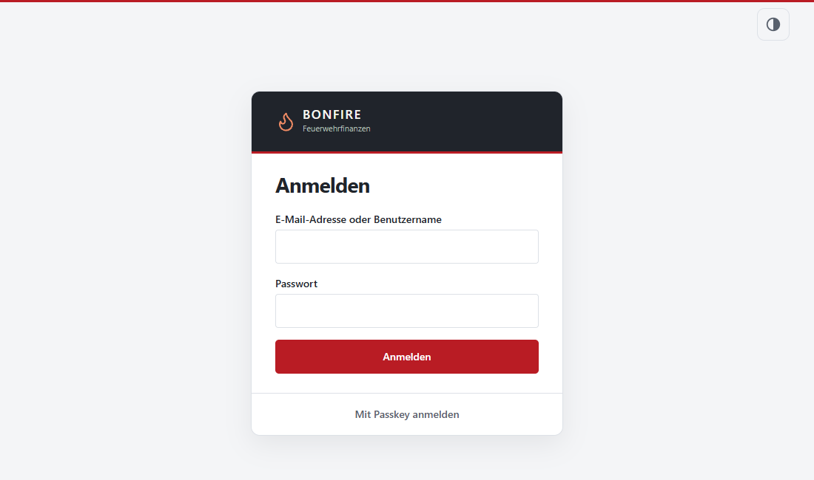

<div align="center">


# BONFIRE

**A self-hosted finance ledger for fire brigades.** Track the cashbook, event income and expenses, cash wallets, donations and sponsorships in an installable web app backed by Go and PostgreSQL.

[](https://github.com/d0linger/bonfire/actions/workflows/test.yml)

</div>

## Screenshots



## Features

- Define fiscal years with arbitrary start and end dates. Choose a year in the sidebar and open its general cashbook or a specific event before posting.
- Record income, expenses, donors, invoice issuers and purchasing notes. Internal transfers move balances between accounts without changing profit. Account allocation is configurable.
- Group event wallets by bar, record opening cash, replenish change and settle individual wallets or the pooled balance. Track claims, partial payments, private advances and reimbursements.
- Use the central contact directory on documents. The document library includes eleven standard profiles. Numbered originals, working copies and reprints have different purposes.
- Review audit events, manage users, inspect system health and configure encrypted local or S3-compatible backups in the administration area.

**Status.** Development and acceptance testing are in progress. The application requires a reachable BONFIRE server. Offline capture, device queues and offline receipt issuance are deferred pending a new specification. Historical records that exist only on a device require separate reconciliation. See the [acceptance matrix](docs/AKZEPTANZ.csv), [implementation register](docs/IMPLEMENTIERUNGSSTATUS.csv) and [offline backlog](docs/offline-backlog.md).

## Quick start with Docker Compose

Install Docker with Compose and PowerShell 7.4 or newer. From the repository root run:

```powershell
./ops/init.ps1
docker compose up -d --build --wait
```

Open [localhost:8137](http://localhost:8137). Sign in as `leitung` using the generated `BONFIRE_ADMIN_PASSWORD` in the local `.env` file. The one-shot migration service initializes the database. The HTTP service uses the separate `bonfire_runtime` role. On an existing installation keep the original credentials and volumes.

In **Geschäftsjahre**, create a fiscal year. Select it in the sidebar, open **Kassenbuch**, and enter an opening balance. Choose **Buchung erfassen**, record income or an expense and verify the posted amount. To book against an event instead, open **Veranstaltungen**, select the event, and use **Zahlungen & Kosten**.

## Configuration and access

The Compose file binds the app to loopback by default. Use a secure origin for installation on other devices and for WebAuthn. Configure the externally visible passkey origin before enrolling credentials. Two cashiers can work concurrently with separate accounts and sessions. The three roles are Admin, Write and Read. Access assignments apply to the selected workspace. Users can manage their password, authenticator, recovery codes, passkeys and sessions.

During a connection failure, keep the form open. If a save was submitted and its response was lost, reload the server state through the dialog and check the entry before entering it again. A missing confirmation leaves the result uncertain.

## Backup, updates and monitoring

Use **Verwaltung → Backup** for schedules, local and S3-compatible destinations, and restore probes. Keep recovery keys separate from archives. Before upgrading, verify a backup in a separate database, retain the previous version and configuration, then rebuild and start with the quick-start command. Never remove data volumes during an upgrade.

The system status view exposes actual runtime, database and backup information. Use the Compose healthcheck and monitoring configuration for deployment diagnostics. See the [operations guide](docs/BETRIEB.md), [backup and restore procedure](docs/VERWALTUNG-BACKUP.md) and [audit and monitoring guide](docs/VERWALTUNG-AUDIT.md).

## Architecture and development

The browser sends authenticated requests to a Go service using pgx and PostgreSQL. Database migrations run before the app starts. The web build bundles local assets and PDF/DOCX renderers. The separate backup worker runs PostgreSQL client tools.

```sh
npm ci
npx playwright install chromium
make lint
make test
npm run build
make test-integration
```

Use the Go toolchain in go.mod, Node.js 22, PowerShell and Docker. The integration suite provisions and removes its own disposable stack. [Test strategy](docs/testing.md) · [Reference comparison](docs/reference-reuse.md) · [Detailed German operating instructions](README.de.md)

## CI, releases and licensing

Pull requests run finance and browser checks, dependency and secret scans, and container scans with commit-linked software bills of materials. The final job aggregates the required results. Extended checks exercise upgrades and fuzzing. The release process requires separate authorization. Physical printing and real-device acceptance are tracked separately.

The repository currently has no project license file. Third-party components retain their respective licenses. [Issues](https://github.com/d0linger/bonfire/issues) · [Releases](https://github.com/d0linger/bonfire/releases)
